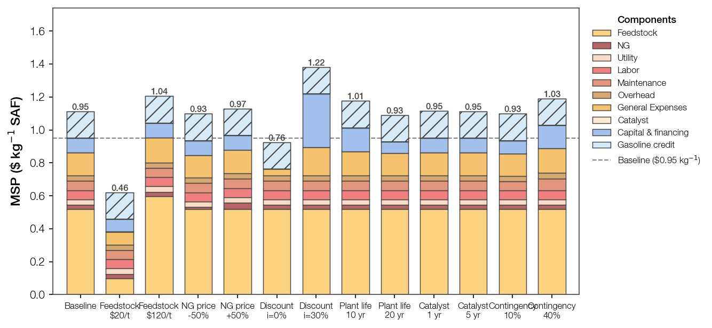
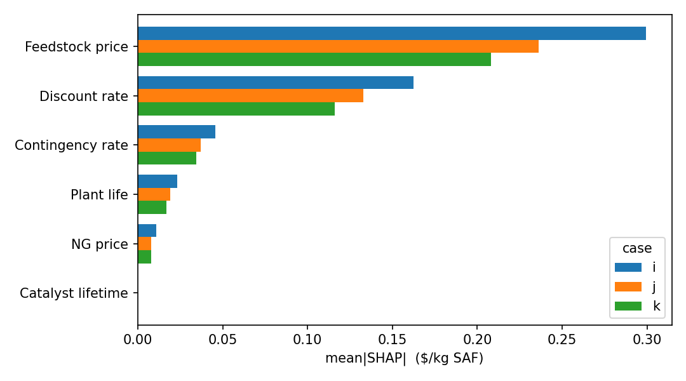
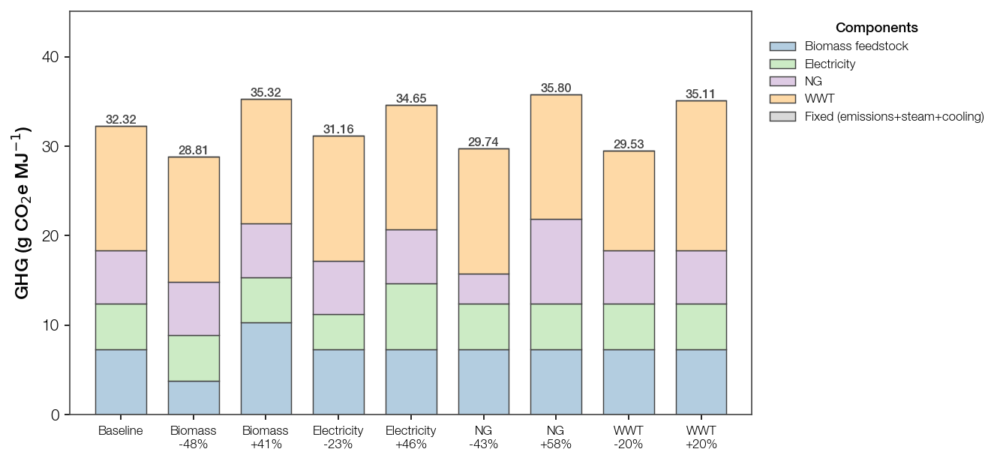
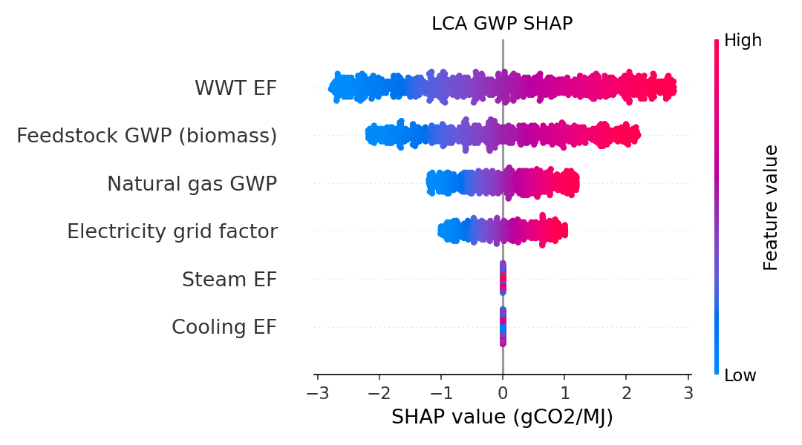

# Sensitivity analysis — parameters, literature basis, and results

**Scope:** TEA (MSP of SAF) and LCA (GHG intensity) sensitivity analysis for the
CEJ reviewer response. Source of truth for baselines and ranges:
`D:\SAF_Nurul\202607_Review_CEJ\SA_references.xlsx` (revised 2026-08-07 after
the literature review). Figures rendered from the SA sweeps in `sa/`.

> Ranges were revised against the literature after the initial ref-check
> (commits `186ffaa`, `b1172b0`). This report documents the **current** Excel
> values; the earlier verdict tables are superseded and not carried forward.

Source codes below map to the peer-SA reference set
(`sa/ref_check/peer_raw/_digest.md`): `m*` = manuscript refs, `SI*` = SI refs.

---

## TEA parameters

Baseline **MSP = $0.95 kg⁻¹ SAF**; full sweep span **$0.46 – $1.22 kg⁻¹**.

| Parameter | Baseline | SA range | Literature basis |
|---|---|---|---|
| Feedstock price | $104.3 / ton | **$20 – $120 / ton** | Davis et al. 2018 (NREL/TP-5100-71949) $80/dry-ton (2011$); m10 (forest-residue FT-SPK) $20/ton; m27 (NREL Jones 2013) up to ~$120/ton (low-ash pine); "Spatially varying GHG-abatement costs" $4–6/gal |
| NG price | $0.55 / kg | **±50%** ($0.28 – $0.83) | SI5 ±10%; SI11 (Winjobi 2017) ±15%; m2 point value 0.245 $/kg. Widened to ±50% for a conservative utility-uncertainty band |
| Catalyst lifetime | 3 yr | **1 – 5 yr** | m26 (PNNL Jones 2009) 0.5–5 yr; reviewer request |
| Discount rate | 0.15 | **0 – 0.30** | m26 ROI 0–30% (0% = plant-gate, 30% = high-return endpoint) |
| Plant life | 15 yr | **±30%** (≈10–20 yr) | SI1 (BECCS FT/bioSNG 2021) plant life ±30% "based on previous studies" |
| Contingency rate | base | **10% – 40%** | Engineering CAPEX-uncertainty lever (tech-maturity, commit `51760e1`); m26 capital-estimate band −10%/+40%. Not a literature value — no citation claimed |

Catalyst lifetime is modelled as annualized replacement OPEX
(`C_inventory / lifetime`); see `sa/README.md`. The published base model
charges no catalyst replacement, so this lever exists only in the SA variant.

### TEA composition

Stacked cost build-up per scenario, dashed line = $0.95 kg⁻¹ baseline.
**Feedstock price dominates** (base contribution ≈ $0.52 kg⁻¹): the $20/t and
$120/t cases move MSP to $0.46 and $1.04. **Discount rate** is second (i=0% →
$0.76 via lost capital-charge; i=30% → $1.22). Plant life, NG price, contingency
are minor; **catalyst lifetime 1–5 yr leaves MSP at $0.95** (annualized
replacement is a negligible share).

### TEA SHAP

mean|SHAP| ($/kg SAF) across cases **i / j / k**. Ranking is stable:
**Feedstock price ≫ Discount rate > Contingency > Plant life > NG price ≫
Catalyst lifetime (≈0)** — consistent with the composition sweep.

---

## LCA parameters

Baseline **GHG = 32.32 g CO₂e MJ⁻¹** (non-CC case); full sweep span
**28.81 – 35.80 g CO₂e MJ⁻¹**.

| Parameter | Baseline | SA range | Literature basis |
|---|---|---|---|
| Biomass GWP | 0.07088 kg CO₂/kg | **0.037 – 0.10** (−48% / +41%) | "GWP of bioenergy pathways in Austria" 15–100 gCO₂/kg; GREET corn-stover 34.6, switchgrass 77.5, forest-residue 37.3 gCO₂/kg |
| Natural-gas GWP | 0.6663 kg CO₂/kg | **0.38 – 1.05** (−43% / +58%) | GREET NA shale gas 0.38; GREET renewable NG 1.05 (range endpoints) |
| Electricity | 0.674 kg CO₂/kWh | **0.52 – 0.986** (−23% / +46%) | SI21 (US LNG/shipping LCA) grid-mix range 0.52–0.986 kg CO₂/kWh |
| WWT | base | **±20%** | No dedicated literature EF; ±20% engineering band (Excel "LCA ±20%"). Dominant LCA contributor |

### LCA composition

Dashed line = 32.32 g CO₂e MJ⁻¹ baseline. **WWT** is the single largest block
(~14 g CO₂e MJ⁻¹) but swept only ±20% (±~2.8). The literature-ranged levers
move the total most: **NG GWP** −43/+58% → 29.74 / 35.80; **biomass GWP**
−48/+41% → 28.81 / 35.32; **electricity** −23/+46% → 31.16 / 34.65.

### LCA SHAP

Beeswarm (g CO₂e MJ⁻¹), colour = feature value. All four are monotone-positive
(higher EF → higher GHG). Spread ranking: **WWT ≈ Biomass feedstock > NG >
Electricity** — WWT's wide swarm reflects its large base share despite the
narrow ±20% input band.

---

## Caveats

- **WWT ±20% is an assumed band**, not a cited value (no matching source in the
  peer-SA set). It is the dominant LCA contributor, so its uncertainty width
  drives the GHG spread more than its citation would suggest.
- **Contingency rate** is an engineering CAPEX-uncertainty lever, not a
  literature parameter.
- **m2 (NG price 0.245 $/kg)** is a manuscript main-text ref outside the peer-SA
  code set; treated as a point comparator, not a range source.
- NG-price ±50% and plant-life ±30% are widened engineering bands; the cited
  studies use tighter swings (±10–15% NG, ±30% plant life).
